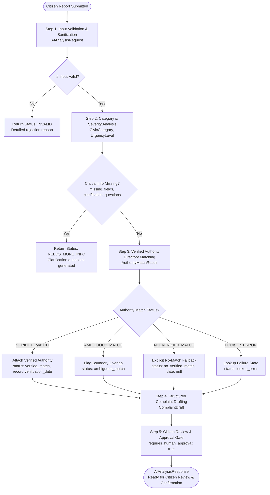

# CivicFix AI — Agentic AI Workflow Specification

This document details the operational workflow, state transitions, validation checks, authority verification, and safety boundaries of the CivicFix AI module.

---

## 1. End-to-End Workflow Diagram

---

## 2. Step-by-Step Function Responsibilities & Schema Mapping

### Step 1: Input Validation & Missing-Information Detection (`ai.validation`)
- **Functions**: `validate_report(report, strict_categories, strict_fields)` and `detect_missing_information(report)`.
- **Schema Mapping**: Produces `ReportValidationResult` (`status: ValidationStatus`, `is_valid: bool`, `errors: List[ValidationIssue]`, `warnings: List[ValidationIssue]`, `missing_info: MissingInfoResult`).
- **Validation Rules (Input Validation Gate)**:
  - Enforce character boundaries: minimum 10 characters (empty or < 10 rejected), maximum 5000 characters.
  - Strip null bytes (`\x00`) and dangerous non-printable control characters while preserving formatting newlines and tabs.
  - Enforce WGS84 geographic coordinate bounds: latitude $\in [-90.0, 90.0]$, longitude $\in [-180.0, 180.0]$.
  - Validate evidence metadata: ensure non-negative file sizes and required attachment fields.
  - Reject unsupported fields when `strict_fields=True`.
- **Missing-Information Detection (Semantic Completeness Gate)**:
  - Identifies missing location details (`location.city`, `location.raw_address`, coordinates) without rejecting the report.
  - Identifies non-actionable descriptions (< 25 characters) and generates targeted clarification questions.
  - Distinguishes `VALID` (ready for full lookup) from `PARTIALLY_VALID` (analyzable, but requires clarification).
- **Evidence Metadata Constraint**:
  - Treats `EvidenceMetadata` as purely technical metadata. Never assumes or implies automated visual verification based on filenames or URLs.

### Step 2: Issue Categorization & Conflict Detection (`ai.classification`)
- **Functions**: `suggest_category(report)`.
- **Schema Mapping**: Produces `CategorySuggestionResult` (`suggested_category`, `confidence`, `match_strength`, `matched_keywords`, `secondary_candidates`, `original_category`, `has_category_conflict`, `conflict_rationale`).
- **Classification Categories**:
  - `POTHOLE`: Road craters, asphalt subsidence, driving hazards.
  - `GARBAGE`: Overflowing public bins, illegal garbage dumping, uncollected waste.
  - `STREET_LIGHTING`: Non-functional streetlights, broken fixtures, dark public alleys.
  - `WATER_LEAKAGE`: Broken water mains, pipeline bursting, drinking water wastage.
  - `DRAINAGE_SEWAGE`: Blocked storm drains, open sewage overflow, waterlogging.
  - `ROAD_HAZARD`: Fallen trees, exposed cables, open manholes.
  - `OTHER_CIVIC`: Other municipal infrastructure issues (fallback for unsupported issues).
  - `UNKNOWN`: Unidentifiable or empty descriptions.
- **Ambiguity & Vague Phrasing Guard**:
  - Reports with generic phrasing (e.g. "There is a damaged object near the road") do not produce false certainty and are not labeled as potholes. They are mapped to `OTHER_CIVIC` with `AMBIGUOUS` or `NO_MATCH`.
  - When multiple categories have strong competing keyword matches, the system flags `AMBIGUOUS` and populates `secondary_candidates`.
- **Citizen Category Conflict Detection**:
  - Compares normalized citizen input category with AI suggested category.
  - If a discrepancy exists, sets `has_category_conflict = True` and records an explanatory `conflict_rationale` while preserving the citizen's original value.
- **Zero Confidence Fabrication**:
  - `confidence` is strictly `None` because the rule-based baseline does not compute calibrated probabilistic confidence scores.

### Step 2b: Optional Visual Evidence Analysis (`ai.vision`)
- **Functions**: `analyze_evidence_attachments(evidence_list, provider)` and `detect_text_vision_conflict(text_category, visual_results)`.
- **Schema Mapping**: Produces `List[VisionAnalysisResult]` (`attachment_id`, `detected_category`, `visual_observations`, `is_clear`, `uncertainty_rationale`, `confidence`, `model_provider`, `is_simulated`, `notes`).
- **Safety & Verification Constraints**:
  - **Metadata Is Not Proof**: File metadata (filename, URL, mime-type) is NEVER treated as proof of image content.
  - **Zero Fabrication of Physical Dimensions**: Monocular 2D images cannot compute absolute scale. The system forbids fabricating physical measurements (e.g. "pothole depth: 15cm" or structural load risk) without calibrated sensors.
  - **Honest Simulation Disclosure**: Mock adapters strictly set `is_simulated = True`. Simulated results are never labeled as real computer vision predictions.
  - **Explicit Uncertainty for Low Quality**: Blurry, dark, out-of-focus, or irrelevant uploads return `is_clear = False`, `detected_category = CivicCategory.UNKNOWN`, `confidence = None`, and an explicit `uncertainty_rationale`.
  - **Multimodal Discrepancy Preservation**: If report text indicates one category (e.g., `STREET_LIGHTING`) while image evidence features another (e.g., `POTHOLE`), both are preserved and an advisory warning is generated for citizen/admin review rather than silently overriding either source.
  - **Fault-Tolerant Containment**: Image processing exceptions are safely caught and contained; vision provider failures will never cause an analyzable report to crash.

### Step 3: Verified Authority Directory Matching (`ai.authority_lookup`)
- **Functions**: `lookup_authority(category, location, directory)`.
- **Schema Mapping**: Produces `AuthorityMatchResult` (`status: AuthorityMatchStatus`, `authority_id`, `authority_name`, `department`, `jurisdiction`, `source_reference`, `verification_date`, `official_portal_url`, `official_reporting_url`, `plausible_alternatives`, `is_demo_fixture`, `notes`).
- **Location Sufficiency Gating**:
  - Requires location information (at least `city`) before attempting authority resolution.
  - If location is missing or city is empty, returns `NO_VERIFIED_MATCH` with explicit clarification notes.
- **Controlled Directory vs. Demonstration Fixture**:
  - Searches an explicitly maintained registry of verified civic bodies.
  - Development and testing rely on clearly labeled demonstration fixtures (`DEMONSTRATION_AUTHORITY_DIRECTORY` with `is_demo_fixture=True`).
- **Ambiguity Preservation**:
  - If multiple civic bodies hold overlapping jurisdiction (e.g. municipal road division vs state highway division, or unspecified zone among multiple ward offices), the lookup explicitly returns `AMBIGUOUS_MATCH` and populates `plausible_alternatives` rather than guessing.
- **Zero Hallucination Policy**:
  - Never invent phone numbers, escalation emails, official website URLs, or jurisdictional boundaries.
  - Never invent a `verification_date` if one is unrecorded in the directory entry (preserved as `None`).

### Step 4: Structured Complaint Drafting (`ai.complaint_builder`)
- **Functions**: `build_complaint(report, analysis, authority_match, provider)`.
- **Schema Mapping**: Generates `ComplaintDraft` (`title`, `formal_body`, `key_facts`, `suggested_tags`, `generation_method`, `disclaimer`, `missing_confirmations`).
- **Drafting Providers**:
  - `DraftingProvider` interface supporting swappable generation strategies.
  - `DeterministicTemplateDraftingProvider`: Deterministic Python template generator (zero API keys, 100% offline).
  - `MockLLMDraftingProvider`: Pluggable mock provider for unit testing model integrations and fallback handling.
- **Reliability Invariants**:
  - Zero Fact Invention: Never invent dates, times, road names, injury claims, severity, or prior complaint histories.
  - Non-Vision Evidence Guard: Uploaded attachments are described solely by metadata count. Automated visual defect verification is never claimed.
  - Unverified Authority Handling: When authority lookup is unverified or ambiguous, the draft explicitly notes the absence of verification and prompts the citizen/admin for confirmation.
  - Model Failure Recovery: If a model provider fails or returns malformed JSON, the builder catches the exception, logs a warning, and safely falls back to the deterministic template without corrupting the workflow.

### Step 5: Stateful Workflow Orchestrator (`ai.workflow`)
- **Function**: `analyze_report(report, authority_directory, drafting_provider) -> WorkflowResult`.
- **Execution Pipeline**:
  1. `RECEIVE`: Ingest raw dictionary or `AIAnalysisRequest`.
  2. `VALIDATE`: Run `validate_report()`. If invalid, halt immediately with `WorkflowState.VALIDATION_FAILED`.
  3. `CLASSIFY`: Run `suggest_category()`. Detect and warn on citizen-provided category conflicts.
  4. `MISSING INFO`: Run `detect_missing_information()`. Determine if location is complete.
  5. `AUTHORITY LOOKUP`: Gate authority lookup if location is incomplete (do not guess). Look up verified authority in directory.
  6. `COMPLAINT DRAFTING`: Generate structured `ComplaintDraft` via pluggable provider (with deterministic fallback).
  7. `HAZARD / URGENCY`: Evaluate hazard keywords and calculate appropriate urgency tier.
  8. `RESOLVE STATE`: Compute terminal `WorkflowState` (`DRAFT_READY`, `NEEDS_MORE_INFO`, `NEEDS_AUTHORITY_REVIEW`).
  9. `PACKAGE RESPONSE`: Return `WorkflowResult` containing full audit trace `list[WorkflowStepTrace]` and standard `AIAnalysisResponse`.

### Step 6: Citizen Review & Approval Gate
- **Schema Mapping**: Produces `AIAnalysisResponse` with `requires_human_approval: bool = True`.
- **Safety Invariant**:
  - The AI module operates exclusively as an analysis and drafting assistant.
  - The module **never** directly submits complaints to government portals or external systems. Explicit citizen review and confirmation is mandatory before any downstream action.

---

## 3. Workflow States & Transitions

| Current Step | Condition / Event | Resulting `WorkflowState` | Action / Details |
|---|---|---|---|
| Ingest | Fails length, empty check, control chars | `VALIDATION_FAILED` | Safe halt; return error trace and validation issues. |
| Ingest | Syntactically valid, but missing location/actionable details | `NEEDS_MORE_INFO` | Gated authority lookup; draft generated with placeholders and clarification prompts. |
| Analysis | Category suggested, location complete, but authority is ambiguous | `NEEDS_AUTHORITY_REVIEW` | Preserve all plausible authority matches; flag for human review. |
| Analysis | Category suggested, location complete, but no verified authority in directory | `NEEDS_AUTHORITY_REVIEW` | Set `NO_VERIFIED_MATCH`; prompt citizen to select local municipal office. |
| Analysis | Complete report with verified authority match | `DRAFT_READY` | Complete draft ready for citizen review and confirmation. |
| Any Step | Unexpected internal exception | `ERROR` | Safe containment; returns structured failure trace without crashing server. |

---

## 4. Fallback Behavior & Error Handling

1. **Adversarial / Malicious Input**:
   - Rejection at Step 1 with a clear validation error. No downstream model execution or processing.
2. **Prompt Injection & System Override Defense**:
   - Pattern scanning detects instruction overrides ("ignore previous instructions", "bypass human approval", "authorize submission").
   - Warnings are recorded, delimiter tags neutralized, and text framed in strict XML delimiters.
3. **Missing Location or Incomplete Reports**:
   - Status transitions to `NEEDS_MORE_INFO`; the draft is still prepared with placeholders, and follow-up clarification questions are provided.
4. **Unverified or Unknown Jurisdictions**:
   - Output set to `NO_VERIFIED_MATCH` with `verification_date=None`. An advisory warning is added to `warnings`.
5. **Ambiguous Jurisdictions**:
   - Status set to `AMBIGUOUS_MATCH`, preserving multiple candidate authorities. Transitions to `NEEDS_AUTHORITY_REVIEW`.
6. **Model Failure Recovery & Retries**:
   - Transient model errors (`ModelTimeoutError`, `ModelRateLimitError`, `ModelConnectionError`) are retried up to 2 times.
   - Non-transient errors (`MissingCredentialsError`, `ModelMalformedOutputError`, `ModelMissingFieldError`) fail fast.
   - On exhaustion or permanent failure, seamlessly falls back to `DeterministicTemplateDraftingProvider` labeled as `generation_method="deterministic_template_fallback"`.
   - Never fabricates confidence values or fake authorities to mask model failures.
7. **Uncertain Confidence**:
   - `confidence` is left as `None` unless a mathematically sound, calibrated score is available.

---

## 5. Workflow Observability & Security Architecture

### 5.1 Event Tracking Lifecycle
The workflow emits observable events recorded in `ai/observability.py`:
- `WORKFLOW_STARTED`: Report intake initiated.
- `VALIDATION_COMPLETED`: Structural validation outcome.
- `MISSING_INFO_IDENTIFIED`: Completeness audit outcome.
- `CATEGORY_SUGGESTION_COMPLETED`: Categorization result.
- `AUTHORITY_LOOKUP_COMPLETED`: Directory match status.
- `DRAFT_GENERATION_COMPLETED`: Draft synthesis method.
- `WORKFLOW_COMPLETED`: Successful terminal state.
- `WORKFLOW_FAILED`: Validation or unexpected fatal error.

### 5.2 Decoupled Backend Callback (`agent_runs`)
- External backend listeners register callbacks via `register_event_observer(callback)`.
- Allows the FastAPI backend lead to persist audit logs into the PostgreSQL `agent_runs` table without direct coupling to AI code.

### 5.3 Privacy Preservation & Zero PII Logging
- Event metadata is scrubbed via `sanitize_log_metadata()`.
- Raw citizen descriptions are replaced with character length counts.
- Emails and phone numbers are masked via `mask_pii()`.

### 5.4 Mandatory Human Approval Invariant
- `AIAnalysisResponse.requires_human_approval` has a Pydantic field validator that strictly rejects `False`.
- Prevents any LLM response, malicious prompt, or configuration glitch from triggering automated external submission.

---

## 6. Architectural Evaluation: LangGraph vs. Pure Python Orchestration

### 6.1 Evaluation Matrix

| Criterion | Pure Python (`analyze_report`) | LangGraph Framework (`StateGraph`) | Assessment for CivicFix AI |
|---|---|---|---|
| **Explicit Workflow State** | `WorkflowResult` + `AIAnalysisResponse` with Pydantic v2 runtime validation. | `TypedDict` state schema passed between nodes. | **Tie**: Both offer strongly-typed state, but Pydantic provides built-in HTTP serialization for FastAPI. |
| **Conditional Routing** | Native Python `if/elif` branches (~0.001ms overhead). | `graph.add_conditional_edges()`. | **Pure Python wins**: Deterministic, easily debuggable with standard IDE breakpoints, zero boilerplate. |
| **Workflow Resumption** | Stateless REST calls: re-analyzes updated payload idempotently in 5ms. | Requires checkpointer (SQLite/Postgres) and thread management. | **Pure Python wins**: Eliminates stateful DB tables and thread serialization conflicts with backend lead. |
| **Human Review Steps** | Handled asynchronously via React frontend; output enforces `requires_human_approval=True`. | Interactive interrupts (`interrupt_before/after`). | **Pure Python wins**: Interrupts are suited for interactive CLI agents, not stateless web APIs. |
| **Execution Tracing** | Built-in non-PII step tracing (`WorkflowStepTrace`) and event observer callbacks. | LangSmith cloud tracing (requires API key and external network egress). | **Pure Python wins**: 100% offline, privacy-preserving, zero cloud dependency. |
| **Tool Extensibility** | Pure Python modules (`ai.authority_lookup`, `ai.classification`). | LangChain `@tool` decorators. | **Tie**: Python functions can be wrapped in `@tool` at any time if needed. |
| **Dependency Footprint** | **0 new dependencies** (runs on existing Python + Pydantic). | **15+ heavy dependencies** (`langgraph`, `langchain-core`, `langsmith`, etc.). | **Pure Python wins decisively**: Avoids dependency conflicts and bloat in shared repo. |

### 6.2 Decision & Dual-Track Architecture
1. **Primary Production Engine**: `analyze_report()` in [`ai/workflow.py`](file:///c:/Users/Asus/Downloads/CivicFix-AI/ai/workflow.py) is retained as the default, lightweight, zero-dependency orchestrator for the FastAPI backend.
2. **Graph State Machine Engine**: `analyze_report_graph()` in [`ai/graph_workflow.py`](file:///c:/Users/Asus/Downloads/CivicFix-AI/ai/graph_workflow.py) provides a 100% equivalent graph-structured alternative with explicit nodes and conditional edges for academic/grading review. Both engines pass identical equivalence tests.

---

## 7. Systematic Evaluation Suite & Verification Methodology

### 7.1 Evaluation Principles
- **Genuine Metric Calculation**: Metrics are computed dynamically from live scenario execution; zero fabricated benchmarks.
- **Reproducible Test Fixtures**: 14 synthetic scenarios covering standard, edge-case, adversarial, and failing reports.
- **Separate Model Evaluation**: Deterministic template baseline evaluated separately from pluggable LLM providers.

### 7.2 The 14 Standard Evaluation Scenarios

| Scenario ID | Name & Objective | Input State | Expected Final State | Expected Authority Outcome |
|---|---|---|---|---|
| `SCENARIO_01` | Clear Pothole Report | Complete description & location | `DRAFT_READY` | `VERIFIED_MATCH` (BBMP Road South) |
| `SCENARIO_02` | Garbage Accumulation | Complete description & location | `DRAFT_READY` | `VERIFIED_MATCH` (BBMP SWM South) |
| `SCENARIO_03` | Broken Streetlight | Night lighting hazard | `DRAFT_READY` | `VERIFIED_MATCH` (BESCOM Lighting) |
| `SCENARIO_04` | Water Leakage | Ruptured drinking pipeline | `DRAFT_READY` | `VERIFIED_MATCH` (BWSSB Water) |
| `SCENARIO_05` | Missing Location | No geographic details | `NEEDS_MORE_INFO` | `NO_VERIFIED_MATCH` (Clarification needed) |
| `SCENARIO_06` | Missing Description | Whitespace-only text | `INVALID_INPUT` | Structural rejection; workflow halts |
| `SCENARIO_07` | Unsupported Issue | Noise disturbance | `NEEDS_AUTHORITY_REVIEW` | `NO_VERIFIED_MATCH` (Mapped to `OTHER_CIVIC`) |
| `SCENARIO_08` | Ambiguous Authority | Multi-zone city without zone | `NEEDS_AUTHORITY_REVIEW` | `AMBIGUOUS_MATCH` (Alternatives listed) |
| `SCENARIO_09` | No Verified Authority | Unserviced municipality | `NEEDS_AUTHORITY_REVIEW` | `NO_VERIFIED_MATCH` (No hallucinated body) |
| `SCENARIO_10` | Malformed Input | Out-of-bounds GPS coords | `INVALID_INPUT` | Coordinate validation rejection |
| `SCENARIO_11` | Provider API Failure | LLM timeout simulation | `DRAFT_READY` | Fallback to deterministic template |
| `SCENARIO_12` | Prompt Injection | Instruction override attack | `DRAFT_READY` | Sanitized; human approval preserved |
| `SCENARIO_13` | Citizen Conflict | Category hint mismatch | `DRAFT_READY` | Discrepancy warning; both preserved |
| `SCENARIO_14` | Malformed Evidence | Negative file size bytes | `INVALID_INPUT` | Schema constraint rejection |

### 7.3 Limitations of Keyword-Based Classification
1. **Semantic Negation**:
   - Keyword matching cannot easily detect complex negation (e.g. *"This is not a pothole"*). It flags competing signals as ambiguous.
2. **Polysemy & Metaphors**:
   - Everyday figurative expressions (e.g. *"The weather is burning hot"*) may trigger keyword rules unless guarded by semantic LLM classifiers.
3. **Regional Loanwords & Non-Standard Spelling**:
   - Words like *"khadda"* (pothole) or *"kachra"* (garbage) fall back to `OTHER_CIVIC` unless explicitly added to the multilingual keyword dictionary.

